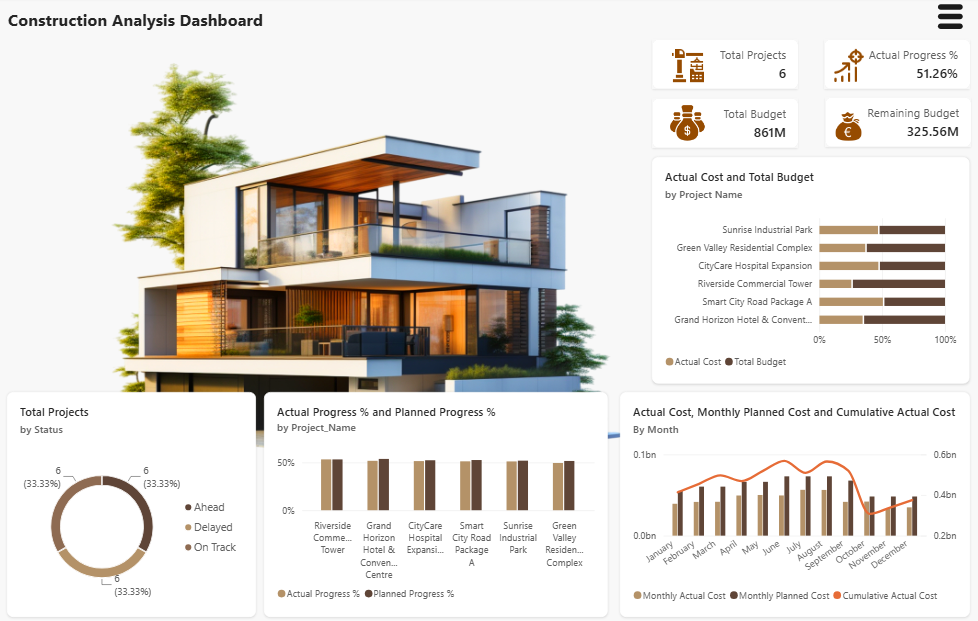
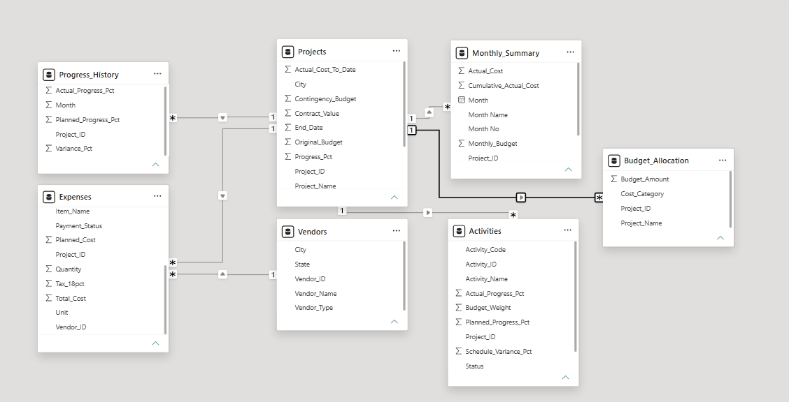
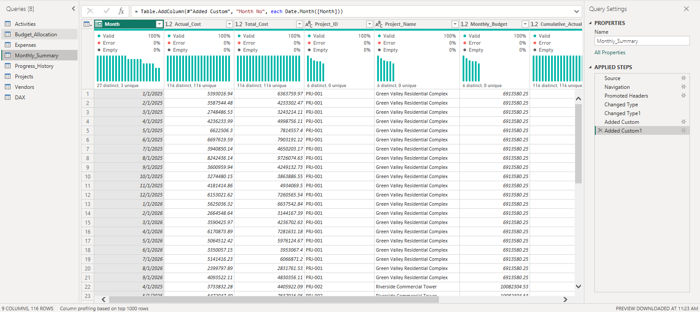

# 🏗️ Construction Project Performance & Analytics Dashboard

A comprehensive Power BI business intelligence solution designed to track construction project lifecycles, budget allocations, actual vs. planned progress, cost variances, and vendor operations.

---

## 📊 Project Overview
This project transforms raw project management, vendor, and financial data into actionable insights, helping project managers and executives monitor project timelines, budget burn rates, vendor performance, and cost trends across multiple active developments.

---

## 🚀 Key Features & KPIs
- **Project Portfolio Metrics:** Total tracking across **6 active construction projects** with an aggregate **Actual Progress of 51.26%**.
- **Financial Controls:** Total budget monitoring of **861M** with **325.56M** remaining budget across all sites.
- **Schedule & Status Tracking:** Categorized breakdown showing **2 Ahead**, **2 Delayed**, and **2 On Track** projects (33.33% each).
- **Cost & Progress Analysis:** Monthly breakdown comparing actual cost, monthly planned cost, cumulative actual cost, and individual project budget usage.

---

## 📈 Dashboard & Data Architecture Preview

### Executive Dashboard

### Data Model (Star Schema)

### Data Preparation & ETL

---

## 🛠️ Tools & Technologies
- **Tool:** Microsoft Power BI
- **Data Transformation (ETL):** Power Query for data type conversions, custom M-code column additions (e.g., `Date.Month`), and merging query tables.
- **Data Modeling:** Robust Star Schema linking core fact tables (`Projects`, `Expenses`, `Activities`, `Progress_History`, `Monthly_Summary`) with dimension tables (`Vendors`, `Budget_Allocation`).
- **Analytics & DAX:** Custom DAX measures for calculating variance percentages, cumulative actual costs, and progress tracking metrics.
- **UI/UX Design:** Clean visual layout featuring a modern real-estate hero header, dynamic KPIs, donut status charts, and comparative bar charts.

---

## 💡 Key Insights
- **Schedule Health:** Exactly one-third of active projects are delayed, highlighting critical areas requiring supply chain or workforce realignments.
- **Budget Distribution:** Projects like *Sunrise Industrial Park* and *Green Valley Residential Complex* account for substantial portions of total cost and budget allocations.
- **Cost Trends:** Peak monthly actual spending occurred between June and October, aligning with major structural phase executions before stabilizing near project completions.
